# EEG Preprocessing Pipeline (MNE-Python)

**A notebook-based pipeline for cleaning high-density (128-channel) EEG recordings: channel clean-up, filtering, manual artifact review, ICA with automatic component labelling (ICLabel) and interpolation, with every rejection decision saved next to the cleaned data.**


## Overview

Raw EEG is rarely analysis-ready: electrodes drift or go noisy, mains interference leaks in, and eye and muscle activity contaminate the signal. This repository packages one consistent way of dealing with all of that in a single, documented Jupyter notebook (`Preprocessing.ipynb`), built on [MNE-Python](https://mne.tools/).

It is a semi-automatic workflow: the parts that are objective (filtering, referencing, ICA, component classification) are scripted, while the judgement calls (which channels and time spans are bad, which components to remove) are made by the analyst, guided by the plots the notebook produces. The decisions are written to disk so a recording's cleaning can be audited or reproduced later.

## Pipeline

```mermaid
flowchart LR
    A["Load EDF or Nihon Kohden .eeg"] --> B["Rename channels, drop DC and GND, set montage"]
    B --> C["Mark standard bad channels"]
    C --> D["Crop, average reference, filter"]
    D --> E["Manual review of PSD and signal"]
    E --> F["Extended Infomax ICA"]
    F --> G["ICLabel classification, exclude artifact components"]
    G --> H["Apply ICA, interpolate bad channels"]
    H --> I["Save cleaned FIF, ICA and rejection log"]
```



| Step | What happens |
|---|---|
| **1. Load** | Reads EDF (`read_raw_edf`) or Nihon Kohden `.eeg` (`read_raw_nihon`) files, preloaded. For `.eeg` files the data are first rescaled according to each channel's gain and calibration. |
| **2. Channel clean-up** | Corrects duplicated and auto-generated channel names, maps them to the montage's channel names (via `channels.csv` for `.eeg`), drops `DC*` and `GND` channels, sets channel types to EEG and applies the 128-channel Brain Products `RNP-BA-128` montage. |
| **3. Pre-marked bad channels** | `AFF4`, `FPZ` and `FCZ` are marked bad by default (the standard interpolations for this setup) and excluded from ICA. |
| **4. Filtering** | Drops the first 5 s (calibration period), re-references to the common average, then applies third-order Butterworth IIR filters with `padlen=0`: a **1–100 Hz band-pass** and band-stops at **47–53, 97–103 and 147–153 Hz** (50 Hz mains and its harmonics). |
| **5. Manual review** | PSD and signal plots (with butterfly view) for spotting noisy channels, which are marked bad, and artifact-laden stretches, which are annotated `BAD`. Regions with eye artifacts (blinks, saccades) are not annotated. |
| **6. ICA** | Extended Infomax, keeping the components that explain 99.99 % of the variance (typically more than 70), with a fixed random seed (`42`) for reproducibility. |
| **7. Component labelling** | [ICLabel](https://github.com/mne-tools/mne-icalabel) assigns each component a class and probability (brain, eye, muscle, heart, line noise, channel noise, …), printed for review. Artifact components are then added to `ica.exclude`. |
| **8. Apply and compare** | ICA is applied to a copy of the data; PSDs before and after are plotted for comparison, and remaining bad channels are interpolated. |
| **9. Save** | Writes the cleaned data, the fitted ICA and a JSON record of the decisions. |

The 1–100 Hz band-pass and average reference are the input conventions ICLabel is designed for.

## Outputs

For an input file `recording.edf`, the notebook writes next to it:

| File | Contents |
|---|---|
| `recording_raw.fif` | Cleaned, ICA-corrected and interpolated data |
| `recording-ica.fif` | The fitted ICA solution |
| `recording_rejections.json` | `bad_channels` and `rejected_components`, i.e. the manual decisions |

## Getting started

```bash
python -m venv .venv
source .venv/bin/activate          # Windows: .venv\Scripts\activate
pip install -r requirements.txt
jupyter lab                        # open Preprocessing.ipynb
```

Developed with **Python 3.11.8**; `requirements.txt` pins the exact package versions (MNE 1.7.0, mne-icalabel 0.6.0, NumPy 1.26.4, scikit-learn, SciPy, and the Qt back-ends).

1. Set `path` (the cell under "Change path in the next cell accordingly") to your EEG file, as a path relative to the notebook's folder; for `.eeg` files also point the channel-mapping line at `channels.csv`.
2. Run the cells in order, choosing the **EDF** or the **.EEG** loading section as appropriate. Use the *new EEG files* renaming cell for EDF recordings made after about April 2022; a commented alternative for older files is included.
3. At the review steps, mark bad channels and time spans, then select components to exclude.

No recordings are included in the repository. The interactive plots use the Qt backend (`%matplotlib qt`), so run the notebook locally on a machine with a display.

## Repository structure

```
.
├── Preprocessing.ipynb   # the full pipeline, with explanatory markdown
├── channels.csv          # raw → standard channel-name mapping (Nihon Kohden .eeg files)
├── requirements.txt      # pinned dependencies
└── LICENSE               # MIT
```

## License

Released under the [MIT License](LICENSE).
